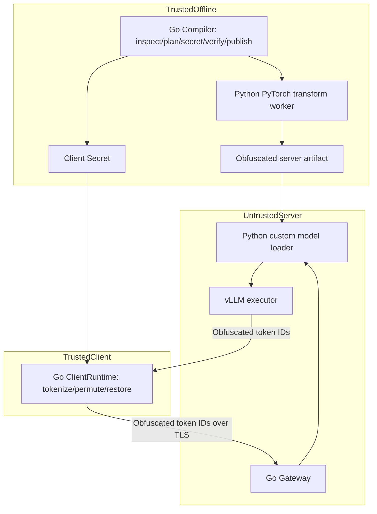

# Architecture (proposed, not implemented)

## Boundaries
Go owns compiler plans, model discovery, safetensors structural validation, secret lifecycle, staging, verification and atomic publish. Trusted offline Python executes PyTorch Tensor transformations with source-model access. The remote Python runtime loads ONLY published obfuscated artifacts and performs inference without Client Secret. Go client owns tokenizer/chat template and original-token mapping; Go gateway handles authentication, model routing, cancellation and streaming, not GPU kernels.

Large Tensors should move via bounded file I/O or mmap, never JSON. Independent math oracle cannot share transform production implementation. Original logical dimensions and transformed physical dimensions have separate contracts.

## Invariants
1. Source and output Tensor inventories are different collections; source/output shape, name and dtype may differ.
2. Reproducibility binds RNG algorithm and method revision, not only seed.
3. No private key data in public manifests, server caches, logs or model sidecars.
4. Runtime artifact ID, binding ID, tokenizer fingerprint and protocol revision must agree.
5. A compiler working-set budget is not a total RSS/GPU-memory guarantee.
