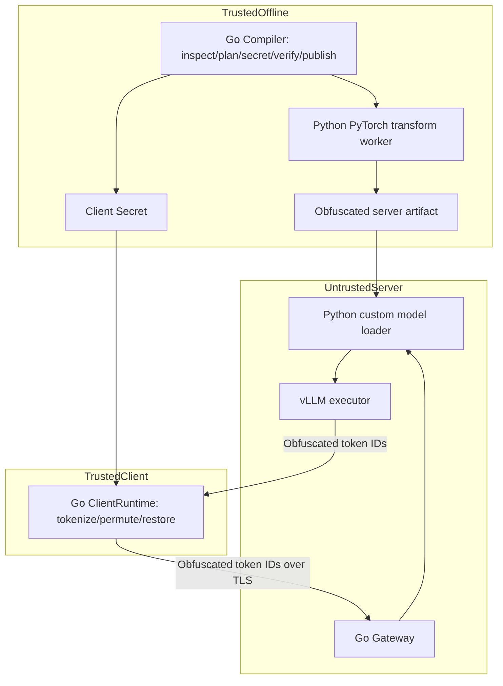

# Architecture (target design; P1–P5 slices and P6 CPU preparation)

## Boundaries
Go owns compiler plans, model discovery, safetensors structural validation, secret lifecycle, staging, verification and atomic publish. Trusted offline Python executes PyTorch Tensor transformations with source-model access. The remote Python runtime loads ONLY published obfuscated artifacts and performs inference without Client Secret. Go client owns tokenizer/chat template and original-token mapping; Go gateway handles authentication, model routing, cancellation and streaming, not GPU kernels.

Large Tensors should move via bounded file I/O or mmap, never JSON. Independent math oracle cannot share transform production implementation. Original logical dimensions and transformed physical dimensions have separate contracts.

## Invariants
1. Source and output Tensor inventories are different collections; source/output shape, name and dtype may differ.
2. Reproducibility binds RNG algorithm and method revision, not only seed.
3. No private key data in public manifests, server caches, logs or model sidecars.
4. Runtime artifact ID, binding ID, tokenizer fingerprint and protocol revision must agree.
5. A compiler working-set budget is not a total RSS/GPU-memory guarantee.

## Implemented P3 slice

DIAGNOSTIC — `internal/clientruntime` and `internal/gateway` implement the
CPU protocol path with a Go fixed physical-ID fake backend. The client owns
Secret and local byte-piece decoding; the gateway owns only public metadata and
fake IDs. It loads no model/artifacts. The Python loader/vLLM path in the target
diagram, real HF tokenization and full transformer inference remain unimplemented.
See `docs/RUNTIME_PROTOCOL.md` for supported API, gates and bounded retry semantics.

## Implemented P4 reference boundary

DIAGNOSTIC — `aloeforge_reference.keymat` / `v2` use pinned NumPy on CPU for
bounded FP64/FP32 toy mathematics, with a separate scalar test baseline and a
software BF16 conversion experiment. The reference imports no transform worker,
real model loader or inference backend. `docs/V2_MATH_AUDIT.md` documents unresolved
paper choices; production/paper-reference admission is explicitly blocked.
P4 does not implement P5 compiler or P6 remote Python/GPU runtime.

## P5 dense diagnostic slice

DIAGNOSTIC — Go `dense` admits exact Qwen2.5 dense tensor semantics and creates
the private transform graph/Client Secret. The independent NumPy worker transforms
bounded row blocks into private files; Go validates descriptors, rebinds source
and atomically publishes a strict custom artifact. The separate NumPy reference
runtime loads only publication and trusted external public identities, with no
source/Secret/worker imports. It implements expanded-coordinate CPU prefill,
decode/cache and greedy. Norm gamma folds offline; an exact sparse isometry with
paired/group/FFN transforms is admitted only as noise-off diagnostic math.
P3's gateway remains fake-only; the P5 runtime is not a production wire backend.
Real checkpoint quality, full method admission and P6 GPU gates remain pending.
See DENSE_COMPILER_CONTRACT.md and P5_VALIDATION.md.

## P6 CPU preparation

DIAGNOSTIC — `aloeforge_runtime` has an independent FP32 PyTorch graph and
custom vLLM model/loader candidate. Artifact validation is shared with P5, while
numerical execution never calls reference forward or the worker. Small CPU mock
geometry passes fixed numeric gates; wider FP32 cache parity remains unresolved
and is explicitly rejected by that mock. The controlled GPU candidate needs actual
hardware evidence. `gateway.NewRelay` exercises a synchronous physical-token
Backend/TokenStream lifecycle, still under P3 mock identities, without dense
binding/IPC or an actual Python process. See VLLM_BACKEND_CONTRACT.md.
